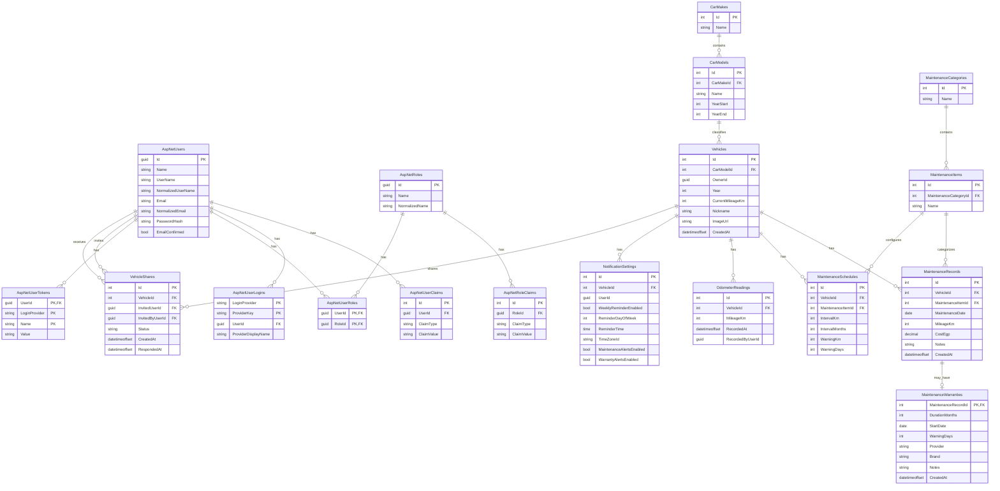

# Database ERD

This diagram reflects `RevivoDbContext` and the latest EF Core model snapshot after migration `20261115145958_AddVehicleShares`. It includes all 11 application tables and 7 ASP.NET Identity tables. The same diagram is available as standalone Mermaid source in [erd.mmd](erd.mmd).

## Schema notes

- `Vehicles.OwnerId`, `OdometerReadings.RecordedByUserId`, and `NotificationSettings.UserId` are GUID columns used by application logic. The database does **not** define foreign keys from these columns to `AspNetUsers`, so the diagram does not show those links.
- `VehicleShares.InvitedUserId` and `InvitedByUserId` **are** separate foreign keys to `AspNetUsers`. `Status` stores `Pending`, `Accepted`, or `Rejected`. A filtered unique index on `(VehicleId, InvitedUserId)` permits only one pending or accepted share for a vehicle and user.
- `MaintenanceWarranties.MaintenanceRecordId` is both the primary key and the foreign key to `MaintenanceRecords`, making the warranty optional and one-to-one from the record's perspective.
- Unique indexes also enforce make names, model names within a make, maintenance category names, item names within a category, one schedule per vehicle and item, and one notification-settings row per user and vehicle.
- The diagram lists key and representative columns. SQL types, nullability, check constraints, indexes, and delete behavior are defined by the EF Core configurations and migrations in `Revivo.Infrastructure/Persistence`.
